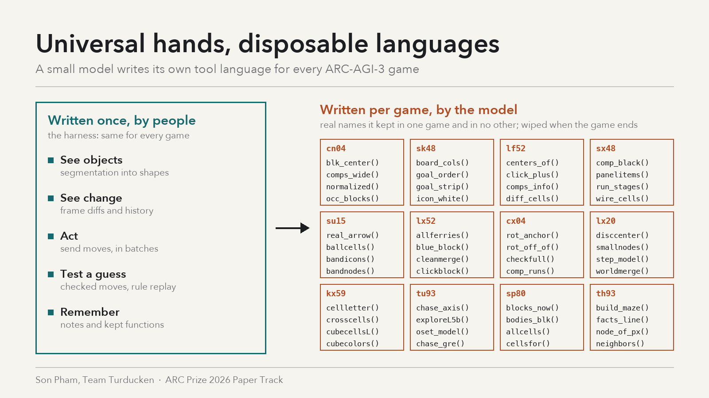

# Universal hands, disposable languages

*A small model writes its own DSL for every ARC-AGI-3 game*

## 1. Summary

Our ARC-AGI-3 agent contains no game-specific code. The harness gives a 4-bit open model universal hands — object segmentation, frame diffs, an action call, a way to test a prediction, a notebook — and lets it keep the Python functions it writes for the rest of a game. The model then builds a small language for each game: `screwcell`, `pinkmap`, `solve`. In a 50-game trace study it kept a median of 88 functions per game, 3,108 distinct names in total, and 2,622 of them were used in only one game. This package was submitted on 28-Oct and scored 53.70 on the public leaderboard; whether the linked script version is that exact submission is pending confirmation by the team.

Our claim: on interactive reasoning tasks the line between universal and specific tools should be drawn by *who writes them*. People write the universal layer once. The model writes the specific layer at test time, and the harness's job is to make that layer cheap to build, easy to test and safe to throw away.

## 2. Setup

The agent is Daniel Franzen's public Milestone 2 harness (built around Tufa Labs' harness) running Qwen3.8-Flash-Next (Intel 4-bit AutoRound) on his SGLang fork with MTP drafting, on one RTX PRO 6000. We added notes memory, goal-first planning, checked play, a fair scheduler across 32 parallel games, and speed work. Each turn the model sees the frame and a diff image; its only tool is a fresh Python sandbox.

## 3. The universal layer

Everything the harness provides works on any 64×64 game:

- **See objects:** `current_frame.segmentation` returns 4-connected same-color objects with color, pixel count, boundary, children, adjacency and rotation-invariant shape hashes. The raw numeric grid is withheld on purpose, so the model reasons over objects, not pixels.
- **See change:** `previous_frame`, `history`, `transitions` and `frame_diff()` (moved, rotated, appeared, disappeared, recolored, resized).
- **Act:** `action([...])`, batchable and callable in loops.
- **Test a guess:** `run_checked([(move, expected_cells), ...])` stops at the first move that doesn't do what the model predicted; `check_rule(rule)` replays a candidate rule against every recorded transition of the level.
- **Remember:** `notes`, one markdown text per game, and **retained functions** — any top-level function the model defines is kept for the rest of the game, re-listed to the model every turn with the reminder *"Their presence does not mean they are correct; revise them if new evidence contradicts their assumptions."* Retained functions are wiped when a new game starts.

The prompt adds only general advice: segment first, diff every move, treat a shrinking edge bar as a timer, and once the rules are clear, search.

## 4. What the model writes on top

We mined the traces of one full board run of this package (50 games: the 25 public games plus 25 "copycat" variants, Kaggle-equivalent time per game, mean 65.3, 27 games won). Two cautions shaped the method: the trace viewer sometimes rebuilds a step from another game's transcript on the same worker, and it doesn't keep every inspection-only turn. So counts come from the harness's own list of retained functions, and code bodies come only from turns verified to belong to that game.

- **Libraries are large and private.** Median 88 retained functions per game (range 2–197). Of 3,108 distinct names, 2,622 appear in one game only.
- **The shared vocabulary is thin.** Only 29 names appear in ten or more games — `state`, `probe`, `snap`, `crop`, `bfs`, `solve`, `bbox` and similar. They make up a median 11% of a game's library.
- **Same name, different meaning.** `snap` in ah25 returns block sets; in ar25 a summary dict; in cx04 bounding boxes of four specific colors. The model reuses a *shape* of tool (take a snapshot, probe a move, search) and fills it with game-specific content.
- **It is code-as-world-model.** About 39% of the definitions whose code survived in the trace hard-code a game color (the viewer keeps mostly acting turns, so this is not a share of the full library). In dx22 the model wrote `screwcell` (find the 16-pixel dark-red ring, map it to a 6-cell lattice), a wall simulator `grid(w, p, mag, org)`, and `solve()`, a BFS over position and four switch states that calls that simulator.
- **It layers.** About 29% of those same visible definitions call another function the model wrote — the beginning of a hierarchy, not a flat list of scripts.

## 5. How a model-written DSL evolves

Classic ARC program-synthesis systems fix a DSL by hand and search over it. Here the DSL is written during play, and four patterns stand out.

1. **Born empty, grows with resistance.** Library size per turn is the same in won and unsolved games (0.81 vs 0.82 functions per turn); unsolved games simply last about twice as long. The language grows as the game fights back, not as a sign of progress.
2. **Short games need almost no language.** sb26 was won 8/8 at full score in a short game with two small helpers (a crop and a cell diff). Consistent with point 1: the library is as big as the fight, and when segmentation and diffs are enough, the model barely writes one.
3. **Interface converges, meaning diverges.** The few shared names are verbs of method (snapshot, probe, search, solve), not nouns of a world. That is the universal/specific split showing up on its own.
4. **Rewrites can silently break dependents.** In dx22, `grid` started as a simulator taking switch states and was later rewritten to read a frame, while `solve()` still called it the old way. "Last definition wins" is how a REPL works, but for a growing DSL it's a versioning bug, and the harness doesn't catch it. About 9% of the definitions we could see were rewritten; turns missing from the trace could hide more, so treat that as a floor.

## 6. Why it works

Three reasons, in order of how sure we are.

**Perception and verification generalize; semantics don't.** Every ARC-AGI-3 game is a 64×64 grid of colored objects changing under a few actions, so object segmentation, diffs and prediction checks transfer across all of them. What a "screw" or a "pink plate" does is different in every game, and any fixed vocabulary for it would be wrong in most of them. Splitting the stack on that line lets one prompt cover 110 unseen games.

**Code makes hypotheses testable.** A function like `screwcell` is a claim about the world. `run_checked` and `check_rule` turn a claim into a test, and the reminder that retained functions may be wrong invites the model to revise them. The DSL is a world model the model can falsify, not a belief that drifts quietly.

**Retention changes what a token buys.** Without retention every helper has to be rewritten every turn, inside a 52k-token window after trims. With it, a function written once on level 2 is a one-word call on level 6. On our board, the memory arms (notes plus retained functions) beat the base by about 3 points over 6 vs 4 runs (95% CI −2.0 to +8.3). That's a lead, not a proof, and the two features were switched on together.

## 7. Results and honesty box

- **Kaggle (110 hidden games):** this package scored 53.70 public on 28-Oct and 50.34 when resubmitted on 30-Oct; that the linked version is the 28-Oct submission is pending confirmation. Our best public score was 56.02 (23-Oct, a sibling package).
- **Board (GCP, 50 games):** 65.3 and 63.0 on two runs. Board noise is about 1.9 points, one standard deviation.
- **Limits:** the trace study covers one run of one package; mined counts are lower bounds; there is no clean ablation of retained functions alone; library size does not predict success.

## 8. What we'd do next

Version the model's DSL: when a function is rewritten, re-test its callers and warn on a signature change. Ship a universal starter kit of the verbs it reinvents anyway (snapshot, probe, search) so it spends tokens on the nouns. And test whether a library carried across related games helps, or whether disposable languages are the point.
