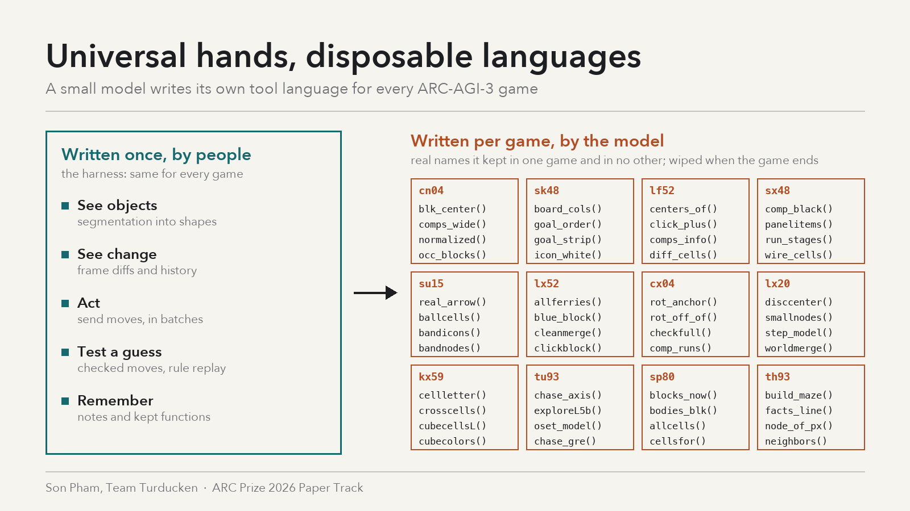

# Universal hands, disposable languages

*A small model writes its own tool language for every ARC-AGI-3 game*

## 1. Summary

ARC-AGI-3 asks an agent to master unseen games under a time budget. Our submission ([notebook](https://www.kaggle.com/code/sonphamorg/arc3-daniel-cnp3k5mx-ff-nosplice-o34g?scriptVersionId=363005415)) answers that with a split. People wrote a small universal toolkit once. The model writes everything game-specific itself, as Python functions it keeps for the rest of the game. Each new game starts with an empty library.

Those functions are acquired skills. A perception skill (`screwcell`: find the dark-red ring and map it to a lattice cell), a world model (`grid`: which walls block a move) and a planner (`solve`: breadth-first search that calls the world model) are written once and then reused as one-word calls. In a 50-game trace study the model kept a median of 88 functions per game; of 3,108 distinct names, 2,622 appeared in one game only. The harness contains no game-specific code.

Our claim: on interactive reasoning tasks, efficient skill acquisition comes from a fixed universal layer plus a per-game language the model writes, tests and throws away.

## 2. Accuracy: the submission

The package was submitted on 28-Oct and scored **53.70** on the public leaderboard (Kaggle submission 57721173, whose description matches this notebook: the 56.02 base notebook plus Marlin rounding, scorecard keep-alive and a fair-floor queue, no splice). Our team records the same package resubmitted on 30-Oct at 50.34. Our team's best public score was 56.02 (23-Oct, a sibling package).

Setup: Daniel Franzen's public Milestone 2 harness (built around Tufa Labs' harness), Qwen3.8-Flash-Next (Intel 4-bit AutoRound) on his SGLang fork, one RTX PRO 6000, 110 hidden games in about 9 hours. We added notes memory, goal-first planning, checked play, a fair scheduler and speed work. The model's only tool is a fresh Python sandbox.

## 3. The universal layer (written once, by people)

- **See objects:** `current_frame.segmentation` returns same-color objects with size, boundary, children, adjacency and shape hashes; the raw grid is withheld.
- **See change:** `history`, `transitions` and `frame_diff()` (moved, rotated, appeared, disappeared, recolored, resized).
- **Act:** `action([...])`, batchable.
- **Test a guess:** `run_checked` stops at the first move that breaks the model's prediction; `check_rule` replays a candidate rule against every recorded transition of the level.
- **Keep skills:** any top-level function the model defines is retained for the rest of the game, across levels, and re-listed every turn with the reminder *"Their presence does not mean they are correct; revise them if new evidence contradicts their assumptions."* Retained functions are cleared when a new game starts. A per-game markdown `notes` text holds confirmed mechanics and hypotheses.

The prompt adds only general method: segment first, diff every move, give each move an expected outcome, and once the rules are understood, stop probing and search.

## 4. What the model acquires, and when

We mined the traces of one full board run of this package (50 games: 25 public games plus 25 "copycat" variants, Kaggle-equivalent time per game; mean score 65.3, 27 games won).

- **What is learned.** Skills are game-specific. About 39% of the visible definitions hard-code a game color. In dx22 the model built a vocabulary (`screwcell`, `pinkmap`, `hud`…), a wall simulator `grid(w, p, mag, org)`, and `solve()`, a breadth-first search over position and four switch states that calls the simulator.
- **Skills compose.** About 29% of visible definitions call another model-written function. The library is a small hierarchy (perception → simulator → planner), not a pile of scripts.
- **When it is learned.** On demand. Library growth per turn is the same in won and unsolved games (0.81 vs 0.82 functions per turn); unsolved games simply last about twice as long (median 129 vs 61 turns). The model writes skills when the game resists.
- **Minimum cost when the universal layer suffices.** sb26 was won 8/8 at full score with two small helpers (a crop and a cell diff).
- **What transfers across games is method, not content.** Only 29 names appear in ten or more games (`state`, `probe`, `snap`, `bfs`, `solve`, `bbox`…), a median 11% of a game's library. `snap` returns block sets in ah25, a summary dict in ar25 and colored bounding boxes in cx04. The model reuses the *shape* of a skill (snapshot, probe, search) and fills it with new content each game.

## 5. Theory: why this acquires skills efficiently

**The split follows what generalizes.** Every ARC-AGI-3 game is a grid of colored objects changing under a few actions, so seeing objects, seeing change and checking predictions transfer to all of them. What a screw or a pink plate does differs in every game. So people pay once for what is universal, and the model pays only for what is new. Hand-built per-game tools cannot exist for hidden games, and a fixed vocabulary of game concepts would be wrong in most of them.

**Code turns a skill into a testable claim.** `screwcell` is a hypothesis about the world. `run_checked` and `check_rule` test it against real transitions, and the retained-function reminder invites revision. A wrong skill gets caught by a failed prediction instead of drifting quietly.

**Retention changes what a token buys.** Without retention every helper is rewritten every turn, inside a 52k-token window after trims. With it, a function written on an early level is a one-word call on every later one, and search over the model's own world model replaces step-by-step probing. Levels "usually build on mechanics learned in earlier levels" (system prompt), so skills written early keep paying.

**Starting empty is a feature.** Clearing the library each game stops stale skills from transferring; only the habit of writing the same kinds of skills carries over.

## 6. Universality and novelty

**Universality.** Nothing in the harness or prompt names a game; the same tools and prompt ran on all 110 hidden games and on official and copycat variants alike. The ingredients (object view, diff, action, prediction test, a place to keep code) exist in any discrete interactive environment, so the recipe should carry beyond ARC.

**Novelty.** Classic ARC program synthesis searches over a hand-written domain-specific language. Skill-library agents such as Voyager keep code skills across tasks in one world. Here the language is written by the model during play, scoped to one unseen game, verified against recorded transitions and discarded at game end. As far as we know this is the first measurement of that process on ARC-AGI-3: library size, vocabulary privacy, layering and drift.

## 7. Progress: what it gives other teams

The pattern is cheap to adopt: a universal toolkit plus function retention, on a 4-bit open model and one GPU. On our board, the memory arms (notes plus retained functions) beat the base by about 3 points over 6 vs 4 runs (95% CI −2.0 to +8.3). That is a lead, not proof.

We also found a failure others can avoid. In dx22, `grid` began as a simulator taking switch states and was later rewritten as a frame reader, while `solve()` still called it the old way. "Last definition wins" works for a REPL, but for a growing skill library it silently breaks dependents. About 9% of visible definitions were rewritten, a floor. Next steps that would raise anyone's score: re-test callers when a skill is rewritten and warn on a signature change; ship the method verbs the model reinvents anyway (snapshot, probe, search) so it spends tokens on game content; and test whether carrying a library across related games helps.

## 8. Completeness and honesty box

This writeup covers the whole submission: model and serving, harness tools, prompt, our additions, what the model writes and how we measured it.

- **Trace study:** one board run (50 games, not the hidden 110). The trace viewer sometimes rebuilt a step from another game's transcript on the same worker and drops some inspection-only turns, so we used only turns verified to belong to each game, took function counts from the harness's own roster, and treat mined code shares as lower bounds.
- **Ablation:** notes and retained functions were switched on together; there is no ablation of retained functions alone.
- **Score mapping** (section 2) is pending confirmation. **Library size does not predict success.**
