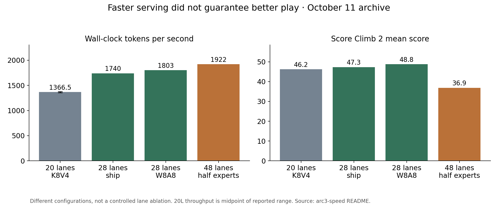
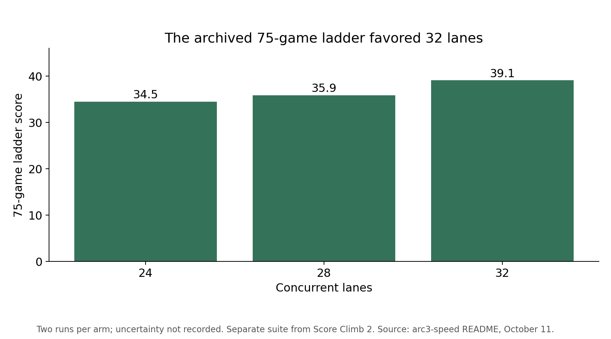
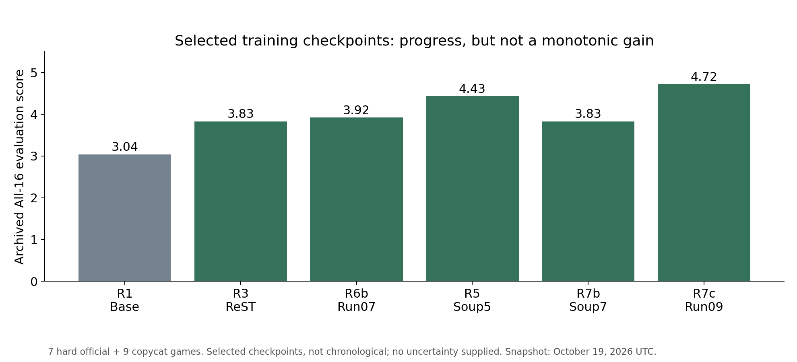

# Stuffing the Turducken

First, thank you to the organizers for an amazing competition—and for the generous free RTX compute that let us pursue so many experiments. Having that hardware available made this project possible, including the ideas that failed.

An ARC-AGI-3 agent has to learn what a game is asking while it plays. Every frame is evidence; every action spends time testing a hypothesis. A useful solver therefore needs more than a model that can reason about pictures. It needs a harness that turns reasoning into experiments, an inference stack that leaves time to run them, and a way to carry discoveries forward when the conversation fills up.

That is our turducken: the playing policy sits inside a tool-using harness, which runs inside a carefully fitted serving system. We worked on all three layers, then explored reinforcement learning to improve the policy itself. The connections mattered as much as the individual pieces. A faster model can try more ideas, but repeatedly rereading a rewritten conversation wastes that advantage. Training can improve a policy, but only if the model being trained behaves like the one being served.

Here we describe the October 18 submission harness and inference configuration, followed by the reinforcement-learning experiments that developed alongside and after it.

## Turning observations into experiments

We built on Daniel Franzen's notebook and agent framework. The model receives a game frame and writes Python in a sandbox to inspect the frame and take actions. This lets it organize a sequence of moves as a small experiment: identify an uncertainty, choose an action that distinguishes possible explanations, and use the resulting frame to update its model of the game.

The harness had to address two familiar failures: analysis without action, and confident action toward the wrong goal. Our working habits were:

- Identify the objective before committing to a long plan.
- Probe unfamiliar mechanics with small, discriminating experiments.
- Batch actions once their effects are understood.
- At a level transition, carry forward the rules but reconsider the plan for the new board.

That loop produces a growing record of frames, code, observations and reasoning. Keeping it useful became both a memory problem and a serving problem.

### Make room without rebuilding the conversation every turn

The selected setup is easier to reproduce as a settings sheet:

| Context and memory setting | Value | Role |
|---|---|---|
| Context window | 143,360 tokens | Total rendered request plus output allowance |
| Maximum output per ordinary request | 12,288 tokens | Reserved generation budget |
| Additional input margin | 512 tokens | Safety margin beyond output reserve |
| Nominal input budget | 130,560 tokens | Window minus output allowance and margin |
| Trim target | Approximately 58,000 tokens | Whole-block cut, not a hard exact retained size |
| Persistent notes cap | 40,000 characters | Separate from token-budgeted history |
| Notes display | Head and tail | Keep early rules and recent discoveries |
| Sampling temperature | 0.5 | Selected October 18 harness |

The temperature-0.5 configuration used a **143,360-token context window** and allowed up to **12,288 output tokens per ordinary model request**. The harness reserved that output allowance plus **512 tokens** of margin, leaving a nominal **130,560-token input budget**. It estimated the rendered request length, so the effective boundary depended on the request rather than token arithmetic alone.

Once the history exceeded the budget, we cut it substantially, targeting approximately **58,000 retained tokens**. Whole message blocks and the latest interaction determined the exact retained length. The large gap between the input budget and the retention target was deliberate: it left room for several turns of growth before the next cut.

This mattered because the server could reuse computation for an unchanged conversation prefix. Its key-value cache holds attention state from tokens already processed; the model also has recurrent state that must be preserved to resume a cached path. Rewriting old messages, even with equivalent reasoning or tidier formatting, can change the rendered token sequence and break that reuse. We therefore preserved generated history as faithfully as possible.

Trimming just enough to squeeze in the next request would keep changing the prefix. A larger, less frequent cut let subsequent requests append to stable history. Each cut still caused recomputation of the affected prefix, and contention or eviction could remove cached state between requests. The aim was to reduce avoidable cache churn, not to depend on permanent residency.

Serving was sized for that workload:

- **32 concurrent request lanes** to batch generation.
- **180 Mamba state slots** for recurrent state.
- **24 GB of host-memory cache** to extend state capacity beyond the GPU.

| Serving setting | Selected value | Purpose / trade-off |
|---|---|---|
| Accelerator | One 96 GB RTX PRO 6000 | Model, active state and concurrent requests share memory |
| Concurrent lanes | 32 | Selected setup, not a universal optimum |
| Recurrent state slots | 180 | Capacity for Mamba states |
| Host cache tier | 24 GB | Extends reusable state beyond GPU memory |
| Routed expert pool | 341 of 512 per layer | Frees memory at the cost of model capacity |
| Routed expert weights | Four-bit | Higher-precision tensors remain elsewhere |
| Selected attention cache | Four-bit | Capacity versus token-quality trade-off |

Attention state, recurrent state and conversation management had to work together; retaining one while repeatedly discarding another would leave part of the benefit unrealized.

### Keep discoveries somewhere a context cut cannot erase

Conversation history records how the agent reached an idea. Explicit notes record what it needs next. We gave those two jobs separate homes.

The harness maintained a persistent Markdown-style notes object outside the temporary Python sandbox. Notes writes streamed back to the harness, allowing already-recorded discoveries to survive a tool timeout. Retained helper functions also spared the agent from rebuilding useful code on every call.

The notes store was capped at **40,000 characters**. When its displayed form needed shortening, the selected head-and-tail mode kept both the beginning and the end: early rules and recent findings could remain visible together. The harness could present the notes again after a context cut or level transition, restoring discovered mechanics, failed approaches and the current plan without restoring the whole conversation.

We also made room for abandoning a bad line of thought. After a prolonged stall, a “fresh eyes” mechanism asked the agent to write a handover note, cleared the conversation, and prompted a fresh look at competing explanations. This deliberately traded cache reuse for a chance to escape an unproductive trajectory. Preserving state is useful only while that state is helping.

## Fitting more play into the time budget

The next layer was inference. The serving stack ran a quantized Flash-Next model on a single **96 GB RTX PRO 6000**, using Daniel's SGLang fork and additional serving patches. The question was how to fit the model, reusable state and concurrent work into the available memory while leaving enough throughput for the agent to explore.

The routed experts used four-bit weights, and routing was restricted to **341 of the original 512 experts per layer**. Reducing the active expert pool freed memory for the rest of the workload at the cost of model capacity. Memory layout, fused operations and kernel tiling were further parts of the same fit. The selected build also used a four-bit attention-cache configuration, with other precision choices elsewhere in the model.

Speculative decoding addressed generation speed. A separately trained multi-token-prediction drafter proposed tokens for the target model to verify. What mattered was how much progress the target accepted per verification step. The drafter and target were therefore a pair: changing the target weights could change acceptance and erase a speed advantage measured against the previous model.

Together, faster generation and less repeated prefill left more wall-clock time for game experiments. That made serving efficiency valuable to the playing agent, while keeping the evaluation questions distinct. Throughput measures how quickly it can try; game evaluations measure whether the attempts work. An internal game score and a Kaggle leaderboard score answer different questions again.

### What the measurements actually showed

The October 11 Score Climb 2 summary makes the trade-off concrete. The 48-lane arm generated more tokens per second, yet scored worse than either 28-lane arm. It also removed more experts and changed context length, so this is **not** evidence that lanes alone caused the loss. It is evidence that optimizing throughput without preserving the playing policy can lose the thing we actually care about. The baseline throughput bar uses the midpoint of its recorded range; its whisker shows that range, not statistical uncertainty.

A separate 75-game ladder favored 32 lanes over 24 and 28, with two runs per arm. Its scores are not on the same evaluation suite as Score Climb 2. Together, these measurements argue for testing the **whole configuration**, not treating a throughput gain as a predicted game-score gain.

- **What these charts support:** measured speed/score trade-offs within named archived workloads.
- **What they do not establish:** a local-to-Kaggle conversion, a clean lane-only ablation, or a final submission result.
- **What is missing:** comparable uncertainty estimates and a matched local/Kaggle series. We do not draw a correlation graph without those paired observations.

[Download the plotted data](charts/chart-data.json) · [Chart sources and reproduction notes](charts/README.md)

### The optimization inventory

We accumulated **102 named kernel-work directories**. That is an inventory of attempts, revisions and measurement tools—not 102 independent improvements, and certainly not 102 changes to enable together. Some replace earlier versions; others were abandoned. Grouping the complete inventory makes the reusable ideas easier to find:

| Category | Named sets and variants | What to reuse—and what to watch |
|---|---|---|
| Dense weights and matrix multiplication | `kfast`, `kfast128`, `kfp8`, `kintn`, `kw4d`, `kw8`, `kw8L`, `kw8a8`, `kw8a8b`, `kw8b`, `kw8bf`, `kw8m`, `kw8x`, `kw8x2`, `kw8x3`, `kgemm256` | Small-batch kernels, precision screens, split-row tactics and activation quantization. INT8 with per-128-input scales was preferable to FP8 in our screen; W8A8 traded precision for speed. Several entries are probes or ablation variants, not shipped improvements. |
| Expert routing and capacity | `kchop`, `kchopp`, `kexp3`, `ktopk`, `kbafuse`, `kbafuse2`, `kroute`, `kmerge`, `kmoebm16`, `kmoefill`, `kmskip` | Mask or physically remove experts, test fewer experts per token, fuse rerouting/remapping, and tune MoE blocks. Exact routing glue and lossy capacity reductions must be evaluated separately; reducing the batch-aware expert count lost score. |
| Attention cache and sparse attention | `kkv44`, `kkv44b`, `kkv44c`, `kkv44d`, `kkv84`, `kkv84f`, `kkv84f2`, `kkv84f3`, `kkv84f4`, `kkv84r`, `kq8`, `kq8cfg`, `kq8cfg84`, `kq8r`, `kqsak`, `kqsapf` | Four/eight-bit key-value formats, fused unpack-and-attend kernels, launch configurations, ring variants, sparse-pick screens and prefill tactics. Quantization creates room for lanes but can weaken token quality; a faster unpack kernel does not remove that trade-off. |
| Attention indexing | `kidx`, `kidxr`, `kmqa`, `kmqa2` | Reuse key tiles across verification rows and split prefill scoring over the key range. Later variants merge earlier patches; they are not independent additive wins. |
| Hyperconnection mixing and launch glue | `khc`, `kglue`, `kglue1005`, `kglue2`, `khcpf`, `khcpf2`, `kbig`, `kbig2`, `kbig3`, `kgate8`, `kpdl`, `kpdl128`, `ktrim` | Fuse mixing, normalization and gates; overlap an early gate; extend tactics beyond 128 rows; reduce launch overhead. Includes a frozen snapshot and unsuccessful early-start/prefetch and single-launch variants. |
| Linear-attention state and convolution | `kconv`, `kgdn`, `kqkvz`, `kfuse`, `kfuse8` | Avoid redundant copies, read strided query/key/value views directly, and fuse or omit redundant work. The full Gated DeltaNet rewrite ultimately ran into the memory-bandwidth floor. |
| Vocabulary heads and sampling | `kdflnext`, `kdhead8`, `kdhead8b`, `kdraft8`, `kdsamp`, `klgf`, `klmh`, `klmh3`, `ktsamp`, `ktsamp2` | Draft-head INT8, compressed target heads, chunk reuse, and top-k-first sampling probes. Draft-only quantization changes proposals; exact target verification is a different guarantee from target-model quantization. |
| Weight placement and pool sizing | `kdupe`, `kdupe8h`, `kembhost`, `kembw8`, `khfree`, `khfree2`, `khfree3`, `khost44` | Host embeddings, merged patch variants, freeing redundant head weights before cache sizing, and a host tier for four-bit attention/recurrent state. Freeing memory after pool sizing was too late to buy cache capacity. |
| Recurrent-cache retention | `kanchor`, `kmamba`, `kkeep`, `kkeep2`, `kmsoft`, `ktail` | Diagnose missing answer-end states; protect or save recurrent state and shared prefixes. Soft protection and newest-tail protection passed local checks but failed to deliver in-server; the keep-slot fix addressed skipped saves under lazy speculative execution. |
| Prefill scheduling and overlap | `kpdmux`, `kpdmuxk`, `kpdmuxk2`, `kpdmuxm`, `kpdshare`, `kpfsync`, `kpgraph`, `kprefill`, `kprio`, `kmix` | Prefill graphs, host-sync removal, split-GPU prefill/decode overlap, stream priority and scratch isolation. Graphing the router at padded row counts could change expert selection; overlap could slow competing kernels enough to lose overall. |
| Request handoff and measurement | `kshm`, `kprof` | Zero-copy multimodal handoff and whole-request profiling. Profiling is tooling, not a model optimization; CPU-side stalls can be invisible in decode-only timings. |
| Speculative acceptance experiments | `krelax` | Relaxed acceptance traded target-distribution fidelity for throughput. Treat it as an answer-changing experiment, not an exact speculative-decoding acceleration. |

The portable recipe is more useful than blindly copying a patch chain:

- **Profile the whole game workload.** Separate generation, prompt reading, image handling and cache re-reads; a decode-only benchmark misses several of the largest stalls.
- **Optimize exact operations first.** Remove copies, redundant work and launch gaps before spending model quality for throughput. Check equality at every relevant row count, including graph replay.
- **For lossy changes, measure both drift and play.** A small numerical error is a screening result, not evidence of improved game solving.
- **Re-sweep concurrency and context together.** More lanes change batch shapes and cache pressure; a faster kernel can move the best operating point.
- **Respect patch order.** Several variants replace entire files. They are alternatives or revisions, not a menu of independent switches.

The [serving-work repository](https://github.com/sonpham-org/arc3-speed) contains the named sets and the kernel ledger. It is access-controlled at the time of this draft; the table above is the self-contained inventory, not a claim that every reader can download the implementation.

## When the local score stopped predicting Kaggle

One of our most important observations was also one of the least satisfying: an improvement on our local evaluation did not reliably produce an improvement on Kaggle. We could make the serving system faster, or raise our internal game score, without knowing whether that change would help on the hidden games. These were three different measurements:

- **Throughput:** how much reasoning and play fit into the time budget.
- **Local game score:** whether the agent improved on the games and settings in our evaluation.
- **Kaggle score:** whether that improvement transferred to the competition’s hidden games.

We tried building our own games to create a separate evaluation set. The aim was to test unfamiliar mechanics rather than keep tuning against the same familiar tasks. The [authored game collection on ARC Explainer](https://arc.markbarney.net/arc3/games) is part of that effort and is available to explore.

Making playable games was not the same as making a useful measuring stick. Ultimately, we did not establish a custom evaluation set whose improvements correlated well enough with Kaggle to guide our decisions confidently. We should not confuse that failure with a lack of interesting games: the missing piece was predictive evaluation. Local results remained useful for diagnosis, but they could not settle which stack would generalize best.

## Training the policy that actually plays

Once the harness could collect useful play, saved game states and trajectories gave us a starting point for training. A saved moment let us branch into several continuations from the same situation and compare their outcomes, without replaying everything that led there.

Earlier experiments included supervised learning on efficient wins, expert iteration over alternative continuations, and a lightweight per-turn coach. Later work moved toward on-policy ReST-GRPO-style training: collect attempts from the current model, score them, update the model, and collect again. The loop connected the training examples to the policy currently making the decisions.

Procedural level generation supplied additional situations. A generator preserved a game's mechanics while changing the instance, and provided a solution that could be replayed through the actual engine. That gave us fresh boards and action baselines instead of relying entirely on a fixed set of hand-authored levels.

The serving decisions followed us into the trainer. It needed the same expert-routing masks as the deployed model; long trajectories required memory-efficient attention and packed expert weights. We also had to keep two training targets straight. Improving the playing policy changes decisions. Improving the speculative drafter can make those decisions arrive faster. Either could help the overall system, but they required different measurements.

The evidence was mixed. The October 18 review recorded earlier weight-training attempts that tied or lost against the base model; the later RL v4 record reported gains on its internal evaluation suites. Those results came from different experiments and measurement settings, so they do not establish the final Kaggle contribution of reinforcement learning. Harness behavior and serving efficiency were already part of the documented submission stack; reinforcement learning remained an experimental track.

### Training progress was real on the internal suite—not a leaderboard promise

The October 19 snapshot records improvement from 3.04 to 4.72 on the held-out All-16 suite, but the seven-way model soup scored below the five-way soup on this particular metric. The bars are selected checkpoint categories, **not chronological training steps**. These are internal scores on seven hard official games and nine copycats, not Kaggle leaderboard scores; the plot does not show that the trained checkpoint improved the submitted system. No variance estimates were recorded in this summary.

## When speed no longer matters

Speed matters while an agent is running out of time to pursue useful ideas. It matters much less when the extra tokens repeat a mistaken explanation or pursue the wrong objective. Our harder question became: when are we short of tokens, and when are we short of better tokens?

Several technically appealing approaches did not pan out:

- **More aggressive compression and expert reduction.** These bought memory and throughput, but could take away the reasoning capacity we were trying to exploit. In the recorded lane experiments, the faster 48-lane, half-chopped configuration scored worse locally than the less aggressively chopped stack.
- **Smarter cache protection.** Protecting a seemingly useful recurrent state looked sensible and passed unit tests, yet could preserve the stale state while the next turn’s needed state was evicted. A plausible cache policy was not enough; the full request lifecycle mattered.
- **Prefill/decode overlap.** Running them together sounded like free utilization. In practice, shared resources, scratch buffers and kernels sized for the full GPU made overlap difficult, and contention could erase the benefit.
- **Rewriting work already at its bandwidth floor.** The linear-attention kernel experiments showed how much engineering can produce little gain when data movement, rather than arithmetic, sets the limit.

Our regrets are about how we chose experiments, not just which kernels we finished:

1. **Gauge when token quality actually matters.** We needed a better way to distinguish a game that would benefit from more exploration from one that needed a stronger next inference. Tokens per second alone could not tell us that.
2. **Ablate backward, not only build forward.** We should have systematically withdrawn optimizations to ask which precision or capacity could be restored in exchange for fewer, better tokens. Some numerical screens and local comparisons were not a substitute for that end-to-end study.
3. **Be less ambitious about recovery.** Restarting a stalled trajectory, writing a handover and preserving notes are useful mechanisms, but they do not ensure that an agent can recover from a wrong model of the game. We put too much hope in rescuing bad trajectories instead of preventing them or recognizing when to stop investing in them.

There was also a trap in having a clear objective. Once we were optimizing a particular operating point, evidence against nearby changes narrowed what we were willing to try. We observed lower performance when moving beyond 32 lanes, so we never tried the more radical idea of running **110 lanes at once**. That does not mean 110 would have worked: it remains untested, and fitting that workload would have required different trade-offs. The regret is that we let a local trend stand in for an experiment on a different regime.

## What held the layers together

The most useful distinction was between **what the agent knows**, **what it is currently doing**, and **what the server has cached**. Notes preserve selected knowledge. Recent history preserves the trajectory. Cached state saves computation for an exact rendered prefix. Calling all three “memory” makes it easy to fix the wrong problem.

Our design followed that distinction: preserve history while it is productive, cut it deliberately when it fills up, restore important discoveries from notes, and restart the reasoning when it stalls. Fit the serving stack around that behavior, then evaluate training in the same environment. Stuffing the pieces together was not enough; they had to leave room for one another to work.

It has been an honor to compete with everyone. Thank you to the organizers and to the other teams for making this such a generous, challenging and memorable competition.

## References

- [Daniel Franzen's ARC-AGI-3 milestone notebook](https://www.kaggle.com/code/dfranzen/arc-agi-3-milestone-2-solution)
- [Game catalog and project viewer](https://arc3.sonpham.net/)
