Review draft · Original Claude artifact restored · Static charts, no animation. Author-reported measurements from the original draft; not newly reproduced benchmarks.

**Son Pham** · Team Turducken · ARC Prize 2026, ARC-AGI-3 · 5th on the public leaderboard, 56.02

# Stuffing the Turducken

Hi everyone! Before anything else, we simply would like to say thank you. Thank you to everyone who has participated in the competition. It has truly been an honor to compete with you all, especially those who have spent the last 6 months giving everything they could in the competition. The level of inference engineering in this competition has truly reached the stratosphere, and that would not have happened without the relentlessness of everyone for the past 6 months.

We would also like to thank you to Tufa Labs, whose harness sits at the very heart of our entry and to Daniel Franzen, for publishing his Milestone 2 notebook. Our solution would not have existed without their generous sharing, and we named our team Turducken to honor their contribution.

Finally, thank you to the ARC Prize Foundation and Kaggle for hosting a wonderful competition.

**Why a turducken?** A turducken is a real American Thanksgiving treat: a deboned chicken stuffed inside a deboned duck, which is then stuffed inside a deboned turkey. The name combines turkey, duck and chicken. That nesting is our metaphor: Tufa Labs' harness is the chicken, Daniel Franzen's notebook is the duck around it, and our engineering optimizations are the outer turkey. Somewhere in October we realized what this competition had turned into: stuffing as much inference engineering into the Turducken as possible.

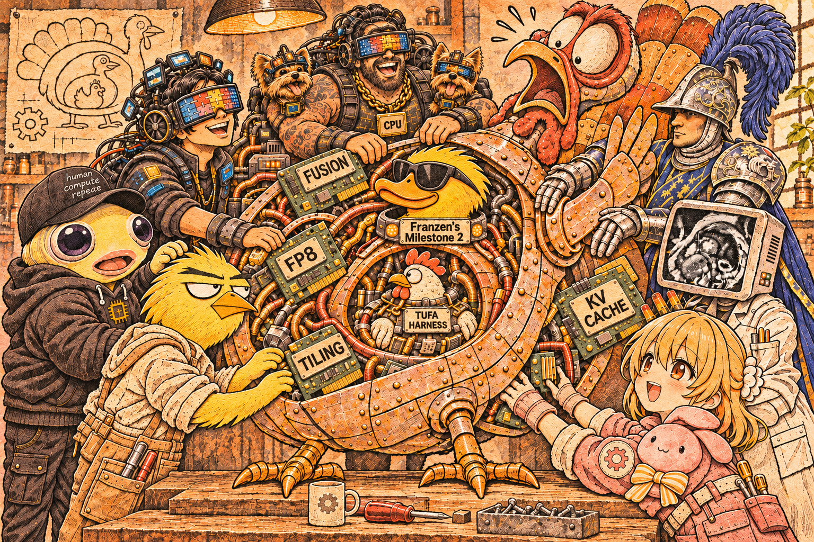

Here's our write-up, in three parts: **the harness**, **the inference optimizations**, and **the RL that didn't work**, then what we learnt. We ran about 1,950 full runs on outside compute during the competition and kept every log, so nearly every number below comes straight out of a log file. When it doesn't, I say so.

### TL;DR

- **Base:** Daniel Franzen's public notebook from 1 October. 110 games on one RTX PRO 6000 in 9 hours.

- **Harness:** notes memory, goal first, checked play, temperature 0.5, and a lot of work on trimming and swapping 110 conversations through one card.

- **Inference:** 191 speed changes tried, 69 shipped. 2,150 tokens per second over a whole run, 32 games at once. Per 1,000 tokens: decode 1,138 → 330 ms, prefill 259 → 74 ms, overhead 255 → 61 ms.

- **RL:** none of our training attempts beat the base model on Kaggle.

- **Two biggest lessons:**
    - We didn't notice when token quality started to matter. After 56.02, every faster build we shipped scored lower.
    - Limited compute pushed us into overly ambitious RL. None of our attempts worked.

## The Harness

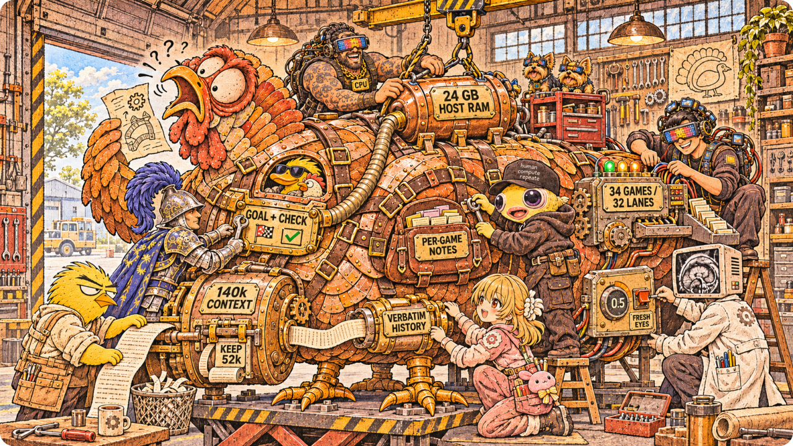

### 1.1 How the harness works

From 1 October we built on Daniel Franzen's public Milestone 2 notebook. Its harness, built around Tufa Labs' harness, runs each of the 110 games as its own conversation with the model, and the model plays by writing code. It has exactly one tool: `python`.

One turn goes like this:

1. The harness sends the current frame as a 512 px image (the 64×64 grid at 8x), an image of what changed since the model's last look, and a short text update on the game's state.

2. The model thinks, then calls `python` with a snippet. The game is preloaded in the sandbox: `current_frame` (the board as objects, with colors, positions and what touches what), `previous_frame`, `history` and `valid_actions`.

3. The snippet plays moves with `action([...])`, one move or a whole planned batch, and the state refreshes after each one, so a single call can probe, loop or run a search.

4. The printed result comes back, and the model can call `python` again, as often as it likes. Each call has a 30-second limit.

On top of that loop, the 56.02 harness keeps these things for the model:

- **Its own functions:** helpers the model writes (a path search, an object finder) stay defined for the whole game and are listed back to it every turn, so a tool built on level 1 is still there on level 6. This is Daniel's option; we set it to last the whole game.

- **Notes memory:** one markdown `notes` text per game, written from inside `python` and held by the harness, so it survives timeouts and history trims. It is shown again after every trim and at every new level, as head + tail once it passes 6,000 characters.

- **Goal first:** on a level's first turn, the model writes what "solved" looks like into its notes before it acts.

- **Checked play:** `run_checked([(move, expect), ...])` plays moves and stops at the first one that doesn't do what was expected; `check_rule(rule)` tests a candidate rule against every recorded move of the level.

- **Sampling:** temperature 0.5 (0.8 → 0.6 → 0.5 over the competition), top-p 0.95, top-k 20.

#### Trim, swap and wipe

Here's the problem. All 110 games open at the start and share one 9-hour clock, but the card holds 3.8M tokens of history and only 32 games can decode at once. So the harness and the server juggle a few moves. Here's what that looks like for one game, and for the whole card at once:

Trim, swap, wipe: how 110 conversations share one card

The three things that can happen to a game's history.

Trim

when the prompt hits 140k

Keep the system prompt, the notes and the last 52k. The prompt no longer matches the cache, so the kept 52k is read again from scratch.

**~340** trims per run, **~46k** tokens each: half of all prompt tokens, **8%** of the clock

Swap

right after a trim

The priority queue can give the slot to one of the 76 waiting games; the trimmed game rejoins the queue. Host RAM keeps a write-through copy of the card's cache.

**34** slots for **110** games; with the RAM copy, games losing their history: **9 → 0**

Wipe

after 120k tokens stuck on one level

The model writes a handover note of at most 400 words, the conversation is cleared, and play continues on the same board.

at most **3** per level

What survives all three: **the notes**, shown again after every trim and at every new level.

Trim counts from the 56.02 board twin's server log: prompt reads of 20k+ tokens that started from an empty cache, two runs.

- **Trim.** When a game's prompt hits the 140k window, the harness keeps the system prompt, the notes and the last 52k tokens. The front of the prompt changed, so the server's cache no longer matches and the kept 52k is read again. A 56.02 board run does about 340 trims of about 46k tokens each: half of all prompt tokens, but only 8% of the clock.

- **Swap.** 34 games hold a slot at a time; the other 76 wait in a priority queue. A game gives up its slot only right after a trim, the one moment it costs nothing because its cache is useless anyway. The queue then picks who plays next: a new game, or one coming back to re-read its kept history.

- **Copy.** Host RAM keeps a 24 GB write-through copy of everything the card caches. If the card has to evict a game's history, it comes back over PCIe instead of being re-read.

- **Wipe (fresh eyes).** When a level eats 120k generated tokens without a clear, the model writes a handover note of at most 400 words, the conversation is cleared, and play continues on the same board. At most 3 times per level.

#### What we can change

The harness has a handful of dials. These are the ones we actually turned:

- **Window and keep:** when a trim fires (128k, then 140k, paid for with fewer Mamba state slots) and how much history it keeps (58k, then 52k).

- **Slots and queue:** how many games hold a slot (32 lanes decode at once; we overpark to 34 games so the card stays busy while a game runs python) and who gets a freed slot. A trim gate that let a trimmed game keep its slot tied.

- **Fresh eyes:** how long a level may stay stuck before a wipe (120k tokens), how long the handover note can be (400 words), and how many wipes a level gets (3). Restarting stuck levels on a timer instead lost at every setting we tried.

- **Notes:** what the model must write (goal first), how long notes are shown in full before head + tail (6,000 characters), and whether notes are per game or shared. Shared notes and fancier memory did no better.

- **Sampling and thinking:** temperature (0.8 → 0.6 → 0.5), top-p 0.95, top-k 20, and caps on thinking per turn, which tied.

- **What a turn shows:** how much text repeats every turn (lean turns), and whether every frame of an in-game animation is shown.

Most of these are lossy: they change what the model says, so the only way to judge one is to play games with it. That is where the hard part was.

### 1.2 How we measure performance

Kaggle gives one submission a day, and a single score is noisy, so we built an offline board. **Score Climb:** 50 games (the 25 public games plus 25 "copycat" games we built, one per public game), 2 to 4 hours per run, 32 lanes, on outside-compute boxes with the same RTX PRO 6000. The loop: **idea → 2 board runs → read the traces → keep or drop → package plus a 10-game readiness run on Kaggle → submit.**

Board noise, from 8 identical controls: one standard deviation is 1.9 points, so two runs only see effects of about 4 points. Most harness ideas were smaller than that, and Kaggle is noisy too: the same package resubmitted moved 3.4. We never had a ruler fine enough to see small changes. (Our later authored games are public in the [ARC-3 Synthetic Games repository](https://github.com/82deutschmark/arc3-synthetic-games); they are not the copycats measured here.)

### 1.3 Performance so far

What moved our Kaggle score, against the package each change was added to:

- **Notes memory: +8.8**, our biggest gain (the same package also restored exact draft acceptance).

- **A bigger window (140k) with temperature 0.5: +5.4.**

- **The speed stack: +3.2**, the 56.02 itself (Part 2).

- **Notes shown as head + tail, with crash fixes: +1.7**, inside Kaggle's own noise.

Everything else we sent to Kaggle scored lower, even when the board liked it. The board liked 12 ideas; Kaggle agreed with 3:

Open or download: [vector SVG](charts/original/delta2.svg) · [high-resolution PNG](charts/original/delta2.png)

Every idea in the chart, in one line each:

| Idea | What it is | Board | Kaggle |
| --- | --- | --- | --- |
| Notes memory, relaxed acceptance off | A notes file per game that survives trims; draft tokens back to exact acceptance | +2.8 | +8.8 |
| Mamba 180, 140k window, temperature 0.5 | A bigger window paid for by fewer Mamba slots; sampling temperature 0.6 → 0.5 | +4.3 | +5.4 |
| Speed stack (the 56.02) | Per-game verify depth, 4 draft steps, 3 guaranteed experts, 52k keep, 34 games over 32 lanes | −1.0 | +3.2 |
| Notes head + tail, OOM fixes | Long notes shown as their start and end; a memory crash in big prompt reads fixed | +1.3 | +1.7 |
| Goal first | Write what "solved" looks like before the first move of a level | +2.9 | −1.5 |
| RL LoRA merged at load | An RL-trained adapter merged into the weights at startup (Part 3) | n/a | −1.7 |
| Expert-kernel rounding, keep-alive, gate | A faster 4-bit expert kernel with slightly different rounding, the scorecard keep-alive, and a fair-share game gate | +0.2 | −2.3 |
| Same package, resubmitted | Nothing changed: this is Kaggle's own noise | n/a | −3.4 |
| Relaxed acceptance 0.7, new drafter | Accept draft tokens more often than exact rejection sampling would | +5.0 | −3.5 |
| Vocab trim | Cut the output layer to the 35,840 tokens we had seen the model use | −0.2 | −3.8 |
| Summary when the window fills | Summarize the history once when it fills, instead of trimming | +0.7 | −4.4 |
| Predict before acting | The model writes what it expects each move to do, and a strict check stops the batch at the first wrong guess | +0.7, +2.3 | −11.5, −4.6 |
| Splice | After a trim, rebuild the cache from the old one instead of re-reading | +2.6, +0.4 | −8.7, −5.3 |
| Lean turns + vocab trim | Shorter turn messages (the rules shown once, not every turn), plus the vocab trim | +1.9 | −9.6 |

Read the two columns together. Nearly everything that lost on Kaggle looked fine or better on our board. That's the lesson of Part 4.

And here is our local board over time. Each dot is one run stored on our run site, [arc3.sonpham.net](https://arc3.sonpham.net), that played all 25 public games, scored on those 25 only. **This is our local public-25 board, not the Kaggle leaderboard**, which scores 110 hidden games. Runs differ in board size and clock length, so the dots are grouped by board and never joined into one line.

[

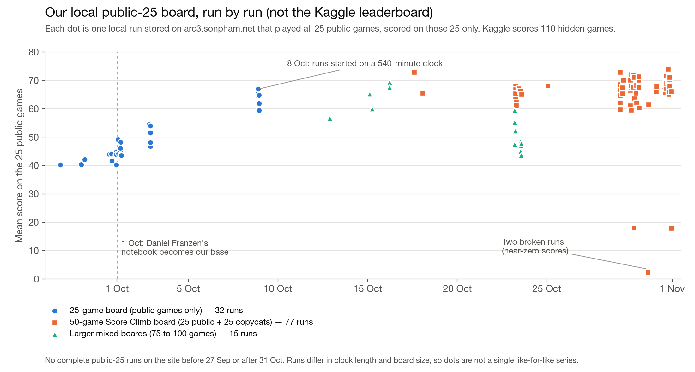

](charts/public25-over-time.svg)

Open or download: [vector SVG](charts/public25-over-time.svg) · [high-resolution PNG](charts/public25-over-time.png) · [every plotted run (CSV)](charts/public25-runs.csv)

Gaps in the data: the site holds only the runs we uploaded, a small share of the roughly 1,950 we ran. It has no complete public-25 run before 27 September or after 31 October, so our first weeks and the 3-bit work from 1 November are missing, and many days have no run at all. Four runs sit far below the rest; two near zero were broken runs, and why the other two scored low was not checked.

Ideas that only ran on the board, none clearly above noise: an animation feed (+7.5 on a 10-game animation subset, nothing on all 25), key-value and curator memory variants, notes shared across games (notes turned out 92% game-specific), a fixed protocol for levels 5+, a state-repeat guard, thinking caps, a rolling summary (22% slower), restarting stuck levels, a trim gate, a symbolic rule finder, and a live coach from a frontier model (no clear win in 113 tries).

Teammates also built harness branches that didn't make the 56.02 package: Keith's sandbox, which keeps a game's Python helpers through a timeout, and Slow∞Loop's (dzj) split memory for game rules and level notes, with a handoff before each trim and verified action facts. Details are in our [merge plan](https://github.com/Autoresearch-Arena/arc-3/blob/main/harnesses/MERGE-OVERVIEW-KEITH-DZJ-1018.md) (team repository).

What the traces told us:

- **Uncleared levels, not efficiency.** Across six board runs of the 56.02 config, about 31 points were lost to levels never cleared and about 7 to move efficiency. Cleared levels 5+ already used 0.65x the human moves (median).

- **Stuck means stuck.** About 19 games per run ended stuck on a level 5+. Giving everyone 4x the clock only took 58 to 64: the losses were stalls (flailing and paralysis), not missing tokens.

- **Loops are common.** 35% of moves in our best board run returned the board to an earlier state.

## Inference Optimization

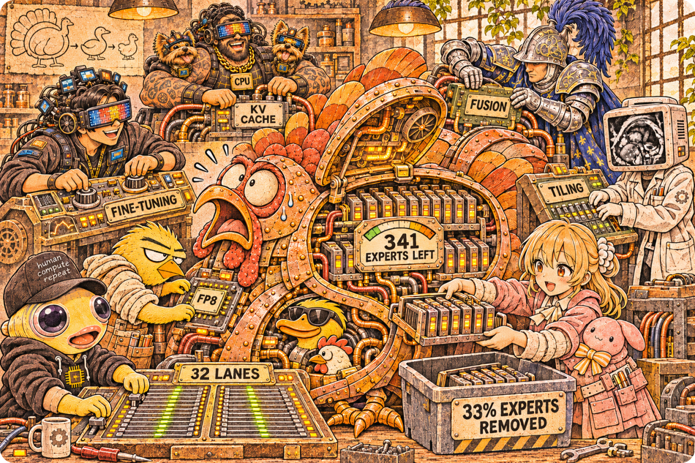

The model is Qwen3.8-Flash-Next with Intel's 4-bit AutoRound weights, served by Daniel Franzen's SGLang fork with MTP drafting. The scored run is 110 games on one RTX PRO 6000 (96 GB) in 9 hours. Every move costs a thousand-plus tokens of thinking, so the card's tokens per second turn into moves, and moves turn into levels.

One rule came before any change: **is it exact or lossy?** An exact change gives the same output bit for bit, so it ships on a speed test alone. A lossy change changes what the model says, so it has to win games first. The biggest lesson at the end is about the times we bent that rule.

The box: one RTX PRO 6000, 110 games, 9 hours

The 56.02 configuration, read from its server startup log. Our box, staircase and cache figures are adapted from Keith Tyser's write-up.

RTX PRO 6000 · 96 GB

34 games admitted · 32 decoding at once

32 lanes decode together; 2 admitted games run python while they wait

weights 46.2draft 6.2history 24.5Mamba 10.1buffers 8.0 GiB

decode step**35.1 ms**accepted per pass**3.25 tokens**experts read per step**~20 GB**

Host RAM · ~177 GB

pinned memory outside the card

**per-layer embedding table**~94 GB in BF16, looked up per token

**copy of the card's history cache**24 GB, write-through

**the rest**python sandboxes, page cache

games110 live · 34 admitted · 32 decoding
clock9 h
experts kept341 of 512 per layer, 4-bit (Intel W4A16)
dense layersint8 weights (one scale per 128 inputs), 8-bit activations above 64 rows
drafterMTP · 4 draft tokens · per-game verify depth
history cacheNVFP4 · 3.80M tokens · 140k window, a trim keeps 52k
speed2,150 tok/s over a whole run on our board
bottleneckmemory bandwidth and games at once

best public **56.02**

Every optimization below is a trade inside this box: free memory to run more games, or make each step cheaper.

### 2.1 The timeline

[

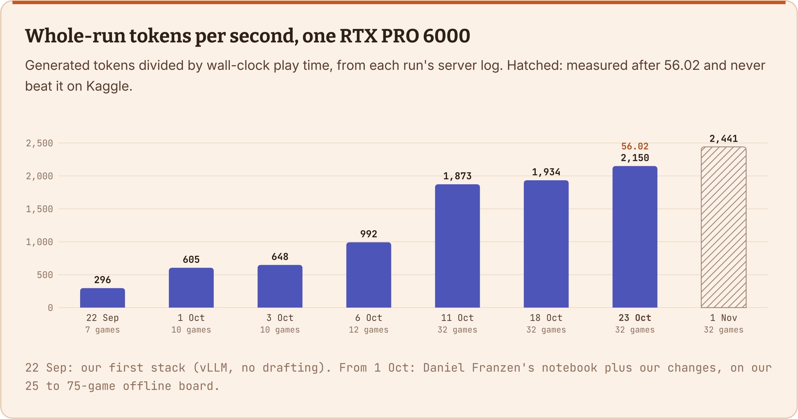

](charts/original/ladder.svg)

Open or download: [vector SVG](charts/original/ladder.svg) · [high-resolution PNG](charts/original/ladder.png)

**Chart data**

| Stage | tok/s | Games at once |
| --- | --- | --- |
| 22 Sep · vLLM, no drafting | 296 | 7 |
| 1 Oct · Daniel's notebook | 605 | 10 |
| 3 Oct · RAM cache tier | 648 | 10 |
| 6 Oct · 8-bit, exact kernels | 992 | 12 |
| 11 Oct · 32 games, expert cut | 1,873 | 32 |
| 18 Oct · 52.82 config | 1,934 | 32 |
| 23 Oct · 56.02 config | 2,150 | 32 |
| 1 Nov · after 56.02 | 2,441 | 32 |

Every second of a run, the GPU is doing one of three things:

- **Decode:** writing tokens. A small draft head guesses 3 to 4 tokens ahead for each game, and the big model checks every guess, for every running game, in one pass.

- **Prefill:** reading prompts. Either the new content of a turn (the new frame, the tool output), or re-reading history the cache lost.

- **Overhead:** everything else. A fixed cost for every prompt read, CPU stalls, and lanes sitting empty.

Here's the same 1,000 tokens at each stage, and how long the card needed for them. Shorter is better.

Decode, per 1,000 tokens

1,138 → 330 ms

71% less

Prefill, per 1,000 tokens

259 → 74 ms

72% less

Overhead, per 1,000 tokens

255 → 61 ms

76% less

[

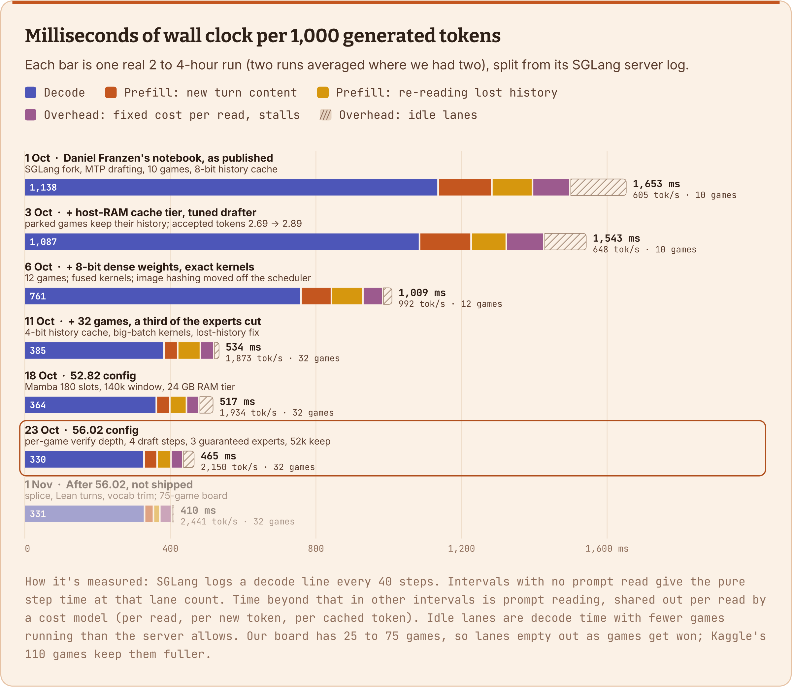

](charts/original/time.svg)

Open or download: [vector SVG](charts/original/time.svg) · [high-resolution PNG](charts/original/time.png)

**Chart data**

| Stage | Decode | New turn | Re-read | Per read + stalls | Idle lanes | Total ms | tok/s | Games | Accepted/pass | Step ms | Runs |
| --- | --- | --- | --- | --- | --- | --- | --- | --- | --- | --- | --- |
| 1 Oct · Daniel Franzen's notebook, as published | 1,138 | 148 | 112 | 103 | 152 | 1,653 | 605 | 10 | 2.69 | 32.3 | daniel-base a + b |
| 3 Oct · + host-RAM cache tier, tuned drafter | 1,087 | 142 | 97 | 103 | 114 | 1,543 | 648 | 10 | 2.89 | 32.7 | hicache aft06 a |
| 6 Oct · + 8-bit dense weights, exact kernels | 761 | 84 | 86 | 55 | 23 | 1,009 | 992 | 12 | 3.06 | 28.3 | bint8v2l12 c + e |
| 11 Oct · + 32 games, a third of the experts cut | 385 | 38 | 63 | 37 | 12 | 534 | 1,873 | 32 | 3.05 | 37.8 | sc2l32ship a + b |
| 18 Oct · 52.82 config | 364 | 37 | 46 | 35 | 36 | 517 | 1,934 | 32 | 3.05 | 36.6 | 52.82 twin a + b |
| 23 Oct · 56.02 config | 330 | 36 | 38 | 33 | 29 | 465 | 2,150 | 32 | 3.25 | 35.1 | 56.02 twin a + b |
| 1 Nov · After 56.02, not shipped | 331 | 25 | 17 | 32 | 5 | 410 | 2,441 | 32 | 3.21 | 34.0 | cmb32 a + b |

The rest of this part takes the three buckets one at a time. Each opens with where it started (left) and where it ended (right); every step in between is one measured build. Numbers in the tables are before → after, measured in the server or in kernel benches on the same card. Code names are ours, so ask about any of them in the comments. Most of this kernel work was done by Claude agents in parallel threads, each with one job and a ledger, with me reviewing and deciding what ships.

### 2.2 Decode: 1,138 → 330 ms per 1,000 tokens

[

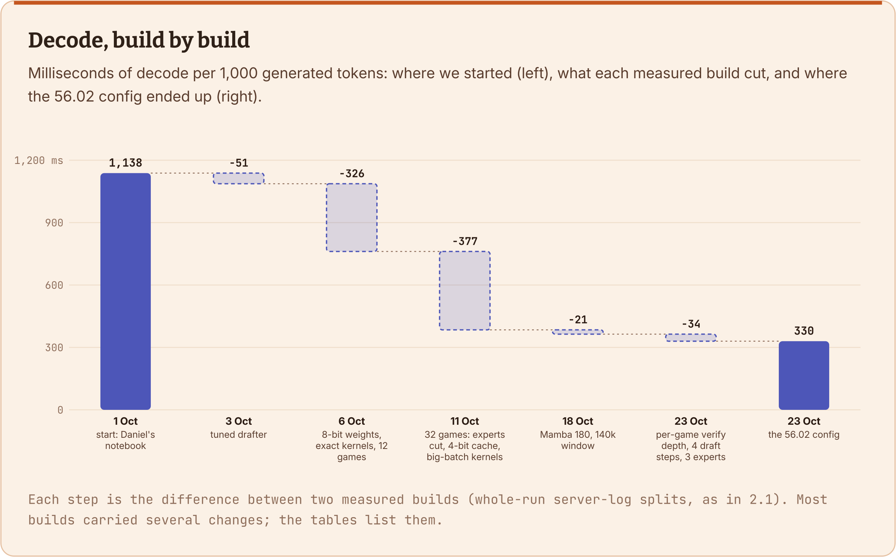

](charts/original/wf-decode.svg)

Open or download: [vector SVG](charts/original/wf-decode.svg) · [high-resolution PNG](charts/original/wf-decode.png)

**Chart data**

| Build | ms per 1,000 tokens | Change |
| --- | --- | --- |
| 1 Oct · Daniel's notebook | 1,138.0 |  |
| 3 Oct · tuned drafter | 1,086.9 | -51.1 |
| 6 Oct · 8-bit weights, exact kernels, 12 games | 761.3 | -325.6 |
| 11 Oct · 32 games: experts cut, 4-bit cache, big-batch kernels | 384.5 | -376.8 |
| 18 Oct · Mamba 180, 140k window | 363.8 | -20.7 |
| 23 Oct · per-game verify depth, 4 draft steps, 3 experts | 330.0 | -33.8 |

Decode is memory-bound. At 12 games, one step reads about **20 GB of expert weights** (166 distinct experts per layer) at 92% of the card's 1.54 TB/s. So clever kernels on the experts hit a wall fast. The two big levers are: **read fewer bytes**, and **serve more games per read**.

[

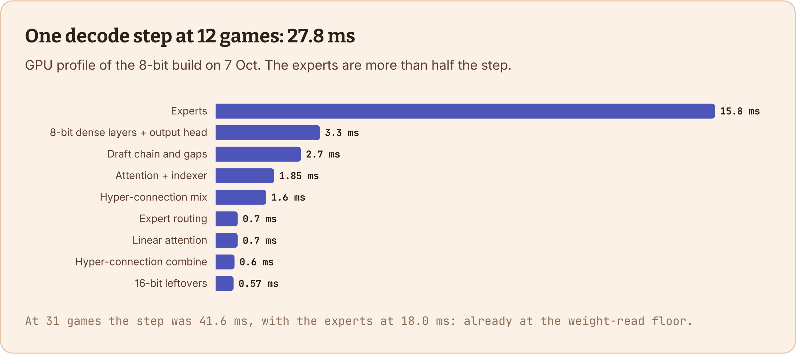

](charts/original/step.svg)

Open or download: [vector SVG](charts/original/step.svg) · [high-resolution PNG](charts/original/step.png)

**Chart data**

| Part of the step | ms | share |
| --- | --- | --- |
| Experts | 15.80 | 57% |
| 8-bit dense layers + output head | 3.30 | 12% |
| Draft chain and gaps | 2.70 | 10% |
| Attention + indexer | 1.85 | 7% |
| Hyper-connection mix | 1.60 | 6% |
| Expert routing | 0.70 | 3% |
| Linear attention | 0.70 | 3% |
| Hyper-connection combine | 0.60 | 2% |
| 16-bit leftovers | 0.57 | 2% |

[

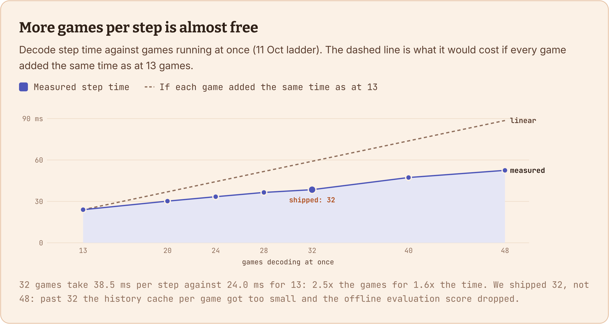

](charts/original/lanes.svg)

Open or download: [vector SVG](charts/original/lanes.svg) · [high-resolution PNG](charts/original/lanes.png)

**Chart data**

| Games | Measured step ms | Linear ms |
| --- | --- | --- |
| 13 | 24.0 | 24.0 |
| 20 | 30.2 | 36.9 |
| 24 | 33.4 | 44.3 |
| 28 | 36.5 | 51.7 |
| 32 | 38.5 | 59.1 |
| 40 | 47.3 | 73.8 |
| 48 | 52.5 | 88.6 |

More games per step needs memory: every gigabyte we freed went to the history cache, and the cache decides how many games can decode at once.

[

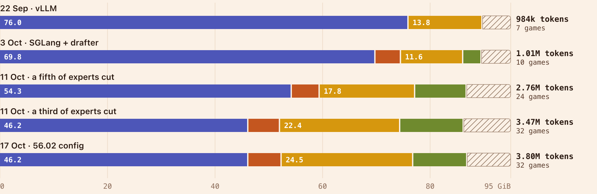

](charts/original/memory.svg)

Open or download: [vector SVG](charts/original/memory.svg) · [high-resolution PNG](charts/original/memory.png)

**Chart data**

| Build | Weights | Draft + cache | History cache | Mamba | Buffers + headroom | History tokens | Games |
| --- | --- | --- | --- | --- | --- | --- | --- |
| 22 Sep · vLLM | 76.00 | 0.00 | 13.76 | 0.00 | 5.21 | 984k | 7 |
| 3 Oct · SGLang + drafter | 69.85 | 4.75 | 11.58 | 3.40 | 5.39 | 1.01M | 10 |
| 11 Oct · a fifth of experts cut | 54.29 | 5.19 | 17.76 | 9.58 | 8.15 | 2.76M | 24 |
| 11 Oct · a third of experts cut | 46.21 | 5.89 | 22.36 | 11.81 | 8.70 | 3.47M | 32 |
| 17 Oct · 56.02 config | 46.21 | 6.19 | 24.48 | 10.05 | 8.04 | 3.80M | 32 |

**Fit more games on the card**

| Change | What it does | Measured |  |
| --- | --- | --- | --- |
| Expert cut | Remove the least-used third of the experts from the card (512 → 341 per layer) | weights 66 → 46.2 GiB | lossy |
| 4-bit history cache | Keys and values in NVFP4 (the draft model keeps FP8) | 1.01M → 3.80M tokens, with the cut | lossy |
| Free the 16-bit output head (khfree) | Serve the head from its int8 copy and free the 16-bit one before the cache is sized | +0.57 GiB | exact |
| Deduplicate shared tensors (kdupe) | The draft and main models held separate copies of the same tensors | +2.04 GB | exact |
| 180 Mamba slots | Fewer spare linear-attention state slots (~55 MB each) | cache 3.47M → 3.80M tokens | exact |
| Peak memory log (kmempeak) | Log the real memory peak so the cache can be sized to the edge | lowest headroom 1.9 GiB | exact |

**Cheaper steps: dense layers and the output head**

| Change | What it does | Measured |  |
| --- | --- | --- | --- |
| 8-bit dense weights (kw8) | Dense layers and the output head in int8, one scale per 128 inputs (3x more accurate than FP8 at the same speed) | step 29.1 → 27.0 ms | lossy |
| 8-bit activations (kw8a8) | Int8 inputs to the dense layers once a step has more than 64 rows | -3.5 ms per step at 192 rows | lossy |
| Int8 kernels by row count (kw8m, kw8x, kw8x3) | Kernels sized for 33-48, 65-96 and 129-256 rows instead of padding | at 80 rows 5.21 → 3.55 ms; at 136 rows 9.7 → 7.7 ms | exact |
| Small 16-bit multiplies (kfast) | A faster kernel for the few dense multiplies left in 16-bit | 9.76 → 9.12 ms per step | lossy |
| Hyper-connection glue (khc, kglue, kglue2, kgate8, kbig3) | The model's layer-mixing steps fused into fewer kernels | kernels per step 2,575 → 2,131; -1.2 ms per step | exact |
| Output head (klgf, klmh3, klmh4) | The int8 head in one launch, writing the final logits directly | 1,641 → 1,475 µs; 1,494 → 1,127 µs at 192 rows | exact |

**Experts and routing**

| Change | What it does | Measured |  |
| --- | --- | --- | --- |
| Batch-aware routing, 3 guaranteed experts | Steer tokens to experts the batch already reads; each token keeps its own top 3 (was 4) | +5% speed | lossy |
| One-kernel reroute (kbafuse, kbafuse2) | The reroute and the cut-expert remap in one kernel per layer | 68-73 → 33-49 µs per layer | exact |
| One-kernel routing (kroute) | Expert selection in one kernel instead of four | 22.3 → 6.9 µs per layer | exact |
| 16-row expert blocks (kmoebm16) | Smaller blocks when each expert gets only a few rows | 696 → 623 µs per layer at 184 rows | lossy |

**Attention**

| Change | What it does | Measured |  |
| --- | --- | --- | --- |
| Attention indexer (kidx, kidxv) | Load each block of keys once per game instead of once per draft token | 98 → 61 µs per layer | exact |
| 4-bit attention (kpf44, kpf44b, kqsort) | Prefetch the next block, split keys 8 ways, read keys in order | 237 → 228 µs; 277 → 265 µs | exact / rounding |
| Linear attention (kgdn, kconv, kfuse, kvdtrim) | Read inputs in place, a one-tile conv, skip state writes for empty slots | 8.5 → 4.1 µs per conv call; +7.5% with kfast | exact |

**More tokens per pass: speculative decoding**

| Change | What it does | Measured |  |
| --- | --- | --- | --- |
| MTP drafting | From Daniel's notebook: a draft head guesses tokens ahead and the big model verifies them in one pass, with exact rejection sampling | 1 → 2.69 tokens per pass | exact |
| Our drafters | Draft heads fine-tuned on our own games, run in int8 | 2.69 → 3.05 per pass | exact |
| Faster draft sampling (kdsamp) | Pick the top candidates first instead of scanning the whole draft vocabulary | 126 → 13 µs per draft step | exact |
| Per-game verify depth (kvd) | Each game verifies only as many draft tokens as it's likely to keep (5 per game, 128 rows at most) | +5% | lossy |
| 4 draft steps | One more guess per pass | 3.05 → 3.25 per pass, with kvd | lossy |
| Draft extend on one row (kdext) | After a verify, the draft model updates only the row it keeps | +5.2% | lossy |

Speculative decoding with rejection sampling is exact on its own. But batch-aware routing picks experts per batch, so anything that changes which rows share a step changes the output slightly. That's why the verify-depth rows count as lossy.

### 2.3 Prefill: 259 → 74 ms per 1,000 tokens

[

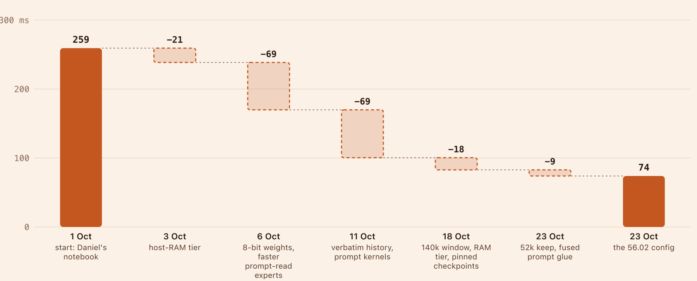

](charts/original/wf-prefill.svg)

Open or download: [vector SVG](charts/original/wf-prefill.svg) · [high-resolution PNG](charts/original/wf-prefill.png)

**Chart data**

| Build | ms per 1,000 tokens | Change |
| --- | --- | --- |
| 1 Oct · Daniel's notebook | 259.3 |  |
| 3 Oct · host-RAM tier | 238.5 | -20.8 |
| 6 Oct · 8-bit weights, faster prompt-read experts | 169.8 | -68.7 |
| 11 Oct · verbatim history, prompt kernels | 100.4 | -69.4 |
| 18 Oct · 140k window, RAM tier, pinned checkpoints | 82.8 | -17.6 |
| 23 Oct · 52k keep, fused prompt glue | 73.9 | -8.9 |

Prefill was the sneaky one. At 20 lanes, prompt reading stalled every lane for about 23% of the run, and about 45% of all prompt tokens were **re-reads**: history the cache had already seen and then lost. The biggest prefill wins were about not losing history; the rest were kernels. The single best one was a one-character bug:

One blank line broke the cache on every turn

The harness stored the model's answer with its blank lines squeezed. The next prompt then stopped matching what the server had cached right at that answer, so everything after it was read again.

reused from cachefirst mismatch: re-read every turn

turn Nas cached

system prompttoolsearlier turnsreasoninganswer … **\n\n** · 271 … 

turn N+1as re-sent

system prompttoolsearlier turnsreasoninganswer … **\n** · 198 …new turn

after keeping history verbatim · 10 Oct · 32 games · 2 runs each

previous answer reused**38% → 95-100%**of turns

turn-content tokens read**3.4M → 2.0M**per run

whole-run speed**1,674 → 1,807**tok/s (+8%)

A blank line is one token (271); a single newline is another (198). One character was enough to throw away the cache for the rest of every prompt.

| Change | What it does | Measured |  |
| --- | --- | --- | --- |
| Host-RAM copy (khost44) | A 24 GB write-through copy of the card's cache; evicted history comes back over PCIe | games losing their history 9 → 0; +7.5% tok/s | exact |
| Lost-history fix | A bug that made 48-lane runs re-read whole histories | re-reads 32% → 11% of GPU time | exact |
| Verbatim history | Keep the model's answer byte for byte (figure above) | +8% tok/s | harness |
| Window and trim | 140k window; a trim keeps 52k | re-reads 12% → 8% of the run | harness |
| Pin side-request checkpoints (kpinbranch) | A summary or review call no longer forces the next turn to re-read its history | 1,787 → 2,160 tok/s | exact |
| Image embeddings in RAM (kvlmhost) | Keep image embeddings in RAM instead of re-encoding them after a trim | 454 RAM hits vs 1,172 first encodes by minute 8 | exact |
| Prompt attention (kqsapf, kqsapf2, kmqa) | Better tiles for long prompt reads | 6.06 → 4.95 ms per call | exact |
| No q/k/v copy (kqkvz) | Pass inputs as a view instead of copying them | 412 → 171 µs per layer | exact |
| Fused prompt glue (kglu) | Small copies folded into the prefill kernels | 356 → 206 µs at 8,192 rows | exact |
| Prompt-read experts (kprefill) | A better expert-kernel layout for prompt reads | -19% at 1k tokens, -7% at 8k | lossy |
| CUDA graphs, no host syncs (kpgraph, kpfsync, kprsync) | Small reads were waiting on Python; replay recorded graphs instead | small read 175 → 113 ms | exact / rounding |
| Image encoder attention (fa4) | FlashAttention-4 for the vision encoder | 366 → 87 µs per layer | lossy |
| Memory-light embedding conv (kpleconv) | Run one conv in 2,048-token pieces; fixed a crash that ended whole games on Kaggle | 800 → 281 MB per 8k read | exact |

### 2.4 Overhead: 255 → 61 ms per 1,000 tokens

[

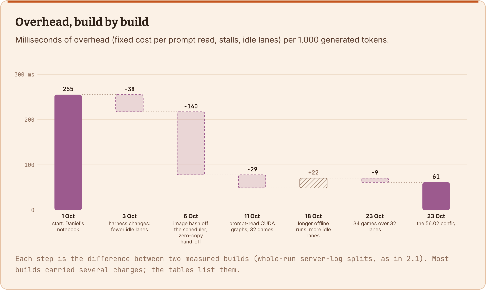

](charts/original/wf-overhead.svg)

Open or download: [vector SVG](charts/original/wf-overhead.svg) · [high-resolution PNG](charts/original/wf-overhead.png)

**Chart data**

| Build | ms per 1,000 tokens | Change |
| --- | --- | --- |
| 1 Oct · Daniel's notebook | 255.2 |  |
| 3 Oct · harness changes: fewer idle lanes | 217.2 | -38.0 |
| 6 Oct · image hash off the scheduler, zero-copy hand-off | 77.7 | -139.5 |
| 11 Oct · prompt-read CUDA graphs, 32 games | 48.9 | -28.8 |
| 18 Oct · longer board runs: more idle lanes | 70.7 | +21.8 |
| 23 Oct · 34 games over 32 lanes | 61.4 | -9.3 |

The best find here was invisible in per-step profiles: for every new request, the scheduler loop SHA-256-hashed about 300 MB of image pixels while every lane waited. 4.2% of the whole run. Only a whole-run timeline showed it. The other half of overhead is lanes sitting empty, which depends on how many games are left to play: our board runs out of games near the end, Kaggle's 110 games mostly don't.

| Change | What it does | Measured |  |
| --- | --- | --- | --- |
| Image hash off the scheduler | Hash images in the tokenizer process, not the scheduler loop | 205 → 8.5 ms stall per image request | exact |
| Zero-copy image hand-off (kshm) | Hand image data over without cloning it | 59 → 2.5 ms per request | exact |
| Overlapped launches (kpdl) | Each small kernel starts while the last one finishes | ~0.23 µs per kernel | exact |
| 34 games over 32 lanes | Two extra games fill lanes left idle by games running python | +4.7 on our 75-game board | harness |
| Startup DNS fix (kdnsfix) | Skip a DNS lookup that Kaggle's offline box never answers | torch init 12.85 s → ~0 | exact |
| Scorecard keep-alive (after 56.02) | Keep the scorecard open during slow model loads (it closes after 15 idle minutes, which gave us a 0.00) | a 46-minute load played normally | harness |

### 2.5 What didn't make it

Of 191 named speed changes, 69 shipped in some build, 71 were dropped, and 51 were parked or never left the test bench. The ones worth knowing about:

- **Relaxed draft acceptance** (accept draft tokens more often than exact sampling would): +5.0 on the board at 0.7, but its Kaggle package dropped 41.97 → 38.45, and 0.5 lost 9 board points. Banned after that.

- **Overlapping prompt reads with decode:** 3 to 5% slower, and out of memory by minute 17-22.

- **Mixing prefill into decode batches:** worth at most ~1%, because every prefill chunk re-reads all the experts.

- **Splice** (rebuild the cache after a trim): tied on the board, lost on Kaggle three times out of three.

- **Vocab trim** (cut the output layer to the tokens we use): lost on Kaggle all three times. About one reply in five wants a token the trim removed, mostly names the model coins for game objects.

- **3-bit experts:** +5% tokens per second and 8.2 GB freed, but the board went 66.2 → 58.7.

- **8-bit Mamba states:** +11% history cache and a board tie, but in our final stack the model thought 35% less per move (Part 4).

## RL

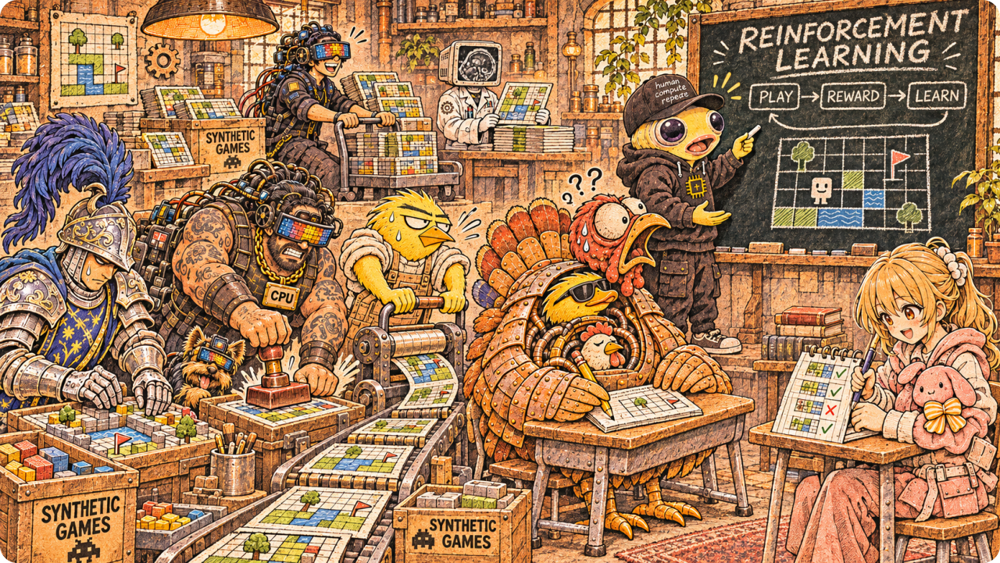

We spent real money and a lot of weekends on RL and other fine-tunes. None of it beat the base model on Kaggle.

| Attempt | When | What | Result |
| --- | --- | --- | --- |
| RL v1 on "burst" moments | 1-4 Oct | LoRA rounds on moments where the harness was sometimes brilliant | hard games 5.8 → 9.5 levels per run, but held-out games 16.8 → 14.6 |
| RL v3, tree rollouts | 13-15 Oct | Branch games from saved states, reward the branches that clear | ~$333 overnight; the one model scored equalled the base (59.98) |
| Evolution strategies | 16-17 Oct | Random LoRA-shaped weight nudges, keep the best each round | best nudge 25.8 vs base 24.9, inside the noise |
| RL LoRAs, merged at load | 19-21 Oct | Keith's RL adapters on our int8 stack | Kaggle 52.82 → 51.12 and → 44.68; our int8 layers kept only 22% of an adapter's change |
| RL5 | 25-26 Oct | Three waves of the same recipe | learned to think half as long (median reply 2,657 → 1,401 tokens); 51.5 → 29.5 |
| GRPO on the log harness | 28 Oct | An adapter trained on the harness we submitted on 25 Oct | board 61.85 → 58.24 |
| Correctors (distillation) | 24 Oct, 1-2 Nov | LoRAs that pull a cut or 3-bit model back toward the full model | KL down 16-23% offline, but thinking 17-45% longer per move; board -9 |
| 2-bit distillation | Keith's write-up | A night on eight B300s to train the 2-bit model back toward 4-bit | ~6,000 training tokens/s against 24-85k planned; no 2-bit weight changed in the layers checked |
| Think-less fine-tunes | 23 Oct | Two public Flash-Next fine-tunes that claim shorter thinking | board 33.5 and 40.3 vs 64.2 |

[

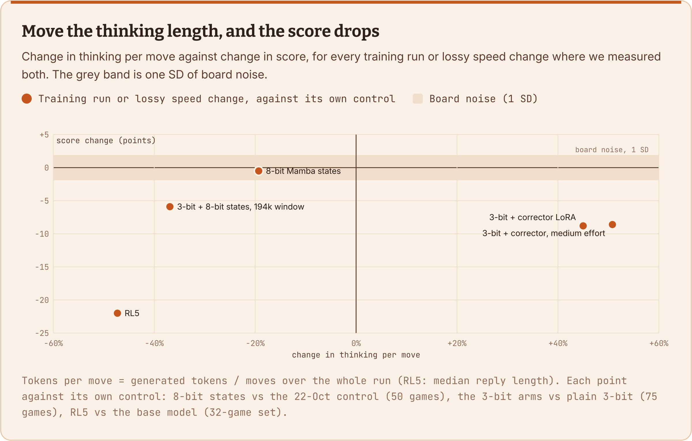

](charts/original/think.svg)

Open or download: [vector SVG](charts/original/think.svg) · [high-resolution PNG](charts/original/think.png)

**Chart data**

| Change | Thinking per move | Score change | Numbers |
| --- | --- | --- | --- |
| 8-bit Mamba states | -19.3% | -0.5 | 961 / 778 vs 1,044 / 1,111 tokens per move; board 60.2 vs 60.7 |
| 3-bit + 8-bit states, 194k window | -36.9% | -5.9 | 639 / 769 vs 1,056 / 1,177; board 45.4 / 43.8 vs 51.9 / 49.0 |
| 3-bit + corrector LoRA | +45% | -8.8 | 1,514 / 1,659 vs 1,037 / 1,151; board 40.2 / 43.1 vs 51.9 / 49.0 |
| 3-bit + corrector, medium effort | +50.8% | -8.6 | 1,592 / 1,707 vs 1,037 / 1,151; board 40.4 / 43.3 vs 51.9 / 49.0 |
| RL5 | -47.3% | -22.0 | median reply 2,657 to 1,401 tokens; 32-game set 51.5 to 29.5 |

Why it didn't work for us: the base model was already good at the games, and every training run we did changed **how long the model thinks** before it changed **how well**. Shorter thinking lost. Longer thinking lost too, because the game is on a clock. Another team saw the same trade (RL helped hard stages but hurt action efficiency) and only switched to their RL model for the last three hours.

## When speed no longer matters

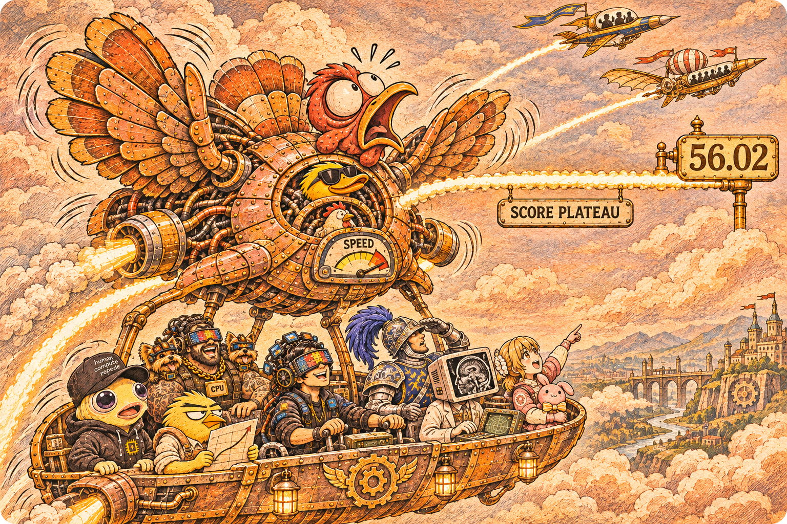

### 4.1 The climb, and what it was telling us

[

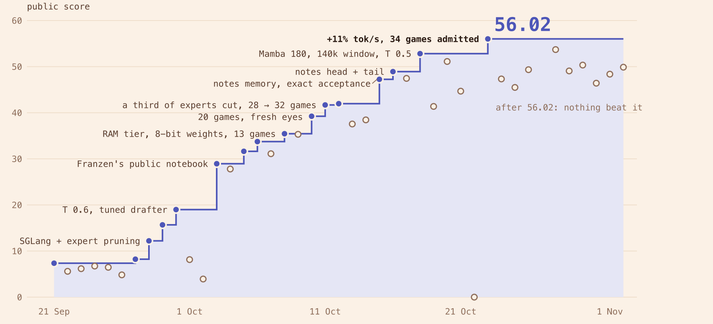

](charts/original/kaggle.svg)

Open or download: [vector SVG](charts/original/kaggle.svg) · [high-resolution PNG](charts/original/kaggle.png)

**Chart data**

| Date | Public score | What changed |
| --- | --- | --- |
| 2026-09-21 | 7.36 | First Flash-Next notebook (vLLM) |
| 2026-09-22 | 5.60 | Prompt deletions |
| 2026-09-23 | 6.17 | Same notebook as 22 Sep, resubmitted |
| 2026-09-24 | 6.74 | Same notebook again |
| 2026-09-25 | 6.47 | Compact prompt v5 |
| 2026-09-26 | 4.83 | Compact v5 resubmitted |
| 2026-09-27 | 8.23 | Moved to SGLang |
| 2026-09-28 | 12.21 | SGLang + expert pruning |
| 2026-09-29 | 15.68 | Pruning + temperature 0.8 + tuned drafter |
| 2026-09-30 | 18.99 | More pruning, temperature 0.6 |
| 2026-10-01 | 8.14 | Different expert set (336) |
| 2026-10-02 | 3.93 | Our harness + Franzen's tool fixes (Combo A) |
| 2026-10-03 | 28.94 | Daniel Franzen's notebook + our drafter + animation feed |
| 2026-10-04 | 27.79 | 4-bit cache, 13 games |
| 2026-10-05 | 31.63 | Host-RAM cache tier + fused 8-bit attention |
| 2026-10-06 | 33.74 | 8-bit dense weights |
| 2026-10-07 | 31.11 | 16-bit line, 11 games |
| 2026-10-08 | 35.45 | 8-bit v3, 13 games |
| 2026-10-09 | 35.32 | 8-bit v3 resubmitted |
| 2026-10-10 | 39.24 | 20 games, 8/4-bit cache, fresh eyes when stuck |
| 2026-10-11 | 41.69 | A third of the experts cut, 28 games |
| 2026-10-12 | 41.97 | 32 games, 8-bit activations |
| 2026-10-13 | 37.56 | Summary when the window fills |
| 2026-10-14 | 38.45 | Relaxed acceptance 0.7 + cache pinning |
| 2026-10-15 | 47.25 | Notes memory + exact acceptance + new drafter |
| 2026-10-16 | 48.92 | Notes head + tail, OOM fixes |
| 2026-10-17 | 47.45 | Goal first |
| 2026-10-18 | 52.82 | Mamba 180, 140k window, temperature 0.5 |
| 2026-10-19 | 41.37 | Predict before acting |
| 2026-10-20 | 51.12 | RL LoRA merged at load |
| 2026-10-21 | 44.68 | Second RL LoRA |
| 2026-10-22 | 0.00 | Speed stack: model load took 66 min, scorecard closed |
| 2026-10-23 | 56.02 | Speed stack: per-game verify depth, 4 draft steps, 34 over 32 |
| 2026-10-24 | 47.33 | + splice + keep-alive |
| 2026-10-25 | 45.49 | + splice v3 + game log |
| 2026-10-26 | 49.34 | Splice v3 stack alone |
| 2026-10-28 | 53.70 | Expert-kernel rounding + keep-alive + game gate |
| 2026-10-29 | 49.07 | + predict before acting |
| 2026-10-30 | 50.34 | 53.70 package resubmitted |
| 2026-10-31 | 46.41 | Lean turns + vocab trim |
| 2026-11-01 | 48.37 | 53.70 + splice + vocab trim |
| 2026-11-02 | 49.88 | 53.70 + vocab trim |

Our best score went from 7.36 to 41.97 in three weeks, and most steps were speed: SGLang, expert pruning, 8-bit weights, more games at once. Then the harness took it from 41.97 to 52.82 (notes memory, goal first, a bigger window, temperature 0.5), and one last speed push made it 56.02. After that, nothing beat it: nine submissions over the last ten days, all lower.

Looking back at this chart, here's what we should have done:

- **Change strategy when the curve flattens.** The signs were there. On 9 October, 4x the clock only took the board from 58 to 64. On 23 October, +11% tokens per second bought +3.2 on Kaggle; the next speed builds bought nothing or less. When more tokens stop buying score, the next point lives somewhere else: in the 31 points we lost to levels the model never cleared, not in the speed.

- **Price every speed trick in quality, not just tokens.** Each change after 56.02 bought tokens by making each one a little worse: a cache rebuilt instead of re-read, a word the model wasn't allowed to say, experts at 3 bits. 4.2 is about this.

- **Don't be too ambitious with correction and RL.** 3-bit experts already gave +5% tokens per second and 8 GB of memory, for about 7 points on the board. 2-bit gave +23% and 19 GB, but scored about 30-35 against 54 for 4-bit (Keith's numbers). We put the big correction push into 2-bit: a night of distillation on eight B300s, after which not one 2-bit weight had changed in the layers we checked. We only started correcting 3-bit on 1 November, too late to finish. The smaller gap was the better bet.

### 4.2 The biggest lesson: we didn't notice when token quality started to matter

In turducken terms: we kept stuffing after the bird was full. For most of October, more tokens meant more score, and that trained us to treat every token as the same token. Somewhere between 52.82 and 56.02 that stopped being true, and we didn't notice. After 56.02, **every faster build we shipped scored lower on Kaggle**: splice (47.33, 48.37), Lean turns with vocab trim (46.41), vocab trim alone (49.88).

Our board couldn't see it. In the board-vs-Kaggle chart in Part 1, nearly every lossy change was flat or up on the board and down on Kaggle: each loss was smaller than the board's noise, and Kaggle's 110 games over 9 hours compounded it. When we went back to the logs afterwards, the signs were there: the final 3-bit stack thought 35% less per move and ended 2 to 5 times as many turns without a tool call, and one reply in five wanted a token the vocab trim had removed. Nothing in our gate was looking for that.

What we'd do differently:

- **Measure quality per token directly** for every lossy change: KL against the full model on recorded replies, plus a behaviour check (tokens per move, turns without a tool call, replies cut off mid-thought) on the stored logs. It costs cents and catches what a 2-run board can't.

- **Watch the tokens-to-score curve.** When more tokens stop buying score, stop buying tokens with quality.

- **Treat thinking length as a vital sign.** If a change moves tokens per move by more than ~10% either way, assume it hurts until it proves otherwise.

We should also have ablated backward: withdraw optimizations one at a time to see which capacity or precision was worth restoring for fewer, better tokens. And our objective narrowed our search. Because nearby tests beyond 32 lanes scored worse, we never tried the radical 110-lane regime ourselves. That remained an untested alternative for our stack, not a demonstrated failure.

### 4.3 The rest

- **Count games, not just speed.** Some other teams ran all 110 games at once, at about half our speed per game, with every history in host RAM and a compressed embedding table to make room. We optimized 32 lanes; they optimized for 110.

- **Measure the whole run, not a step.** Our biggest overhead win was invisible in per-step profiles, and prompt reading (~23% of the run) was invisible in SGLang's own throughput line.

- **Memory is throughput.** On a memory-bound decoder, freed gigabytes become lanes and history, and lanes are almost free per step.

- **Know your noise before you read a result.** SD 1.9 on our board; ±3.4 on Kaggle for the same package. A one-point "win" is a coin flip.

- **Treat the prefix cache as a contract.** One squeezed blank line cost us 8% of our speed.

- **Build the dumb safety nets.** A slow model load gave us a 0.00. A keep-alive fixed it.

### Thanks again

Thanks for reading, and thanks again to Tufa Labs, Daniel, Keith and the team. It was a wild ride, and we'd do it again. It has been an honor for us to compete with everyone.

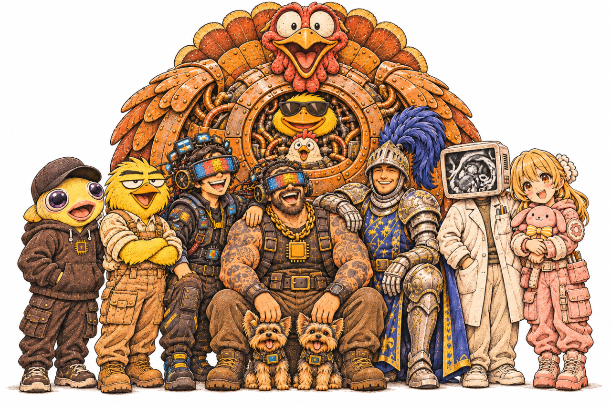

*Thank you for an amazing competition! — Team Turducken*

This post was written with help from Claude. Numbers come from our run logs, server logs and Kaggle's submission history. I've checked them, but if something looks off, ask in the comments and I'll dig up the log.
